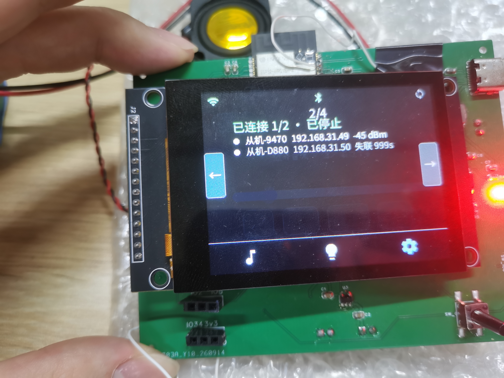
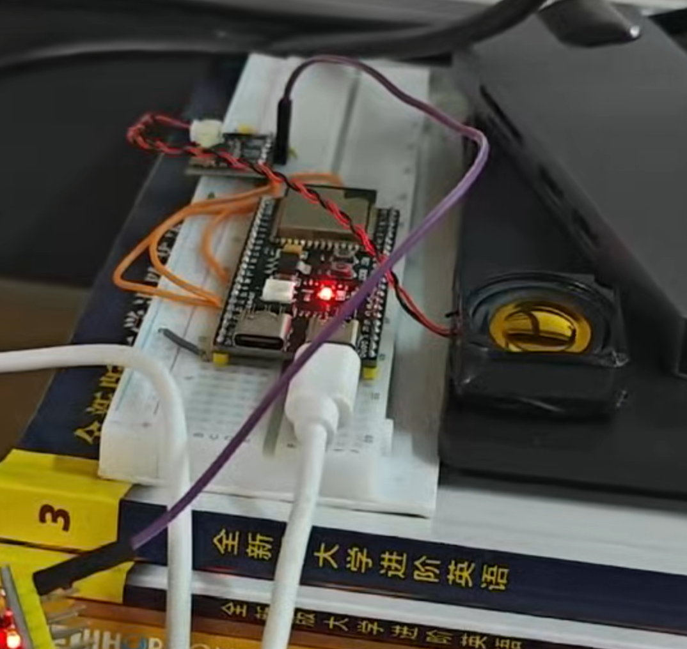
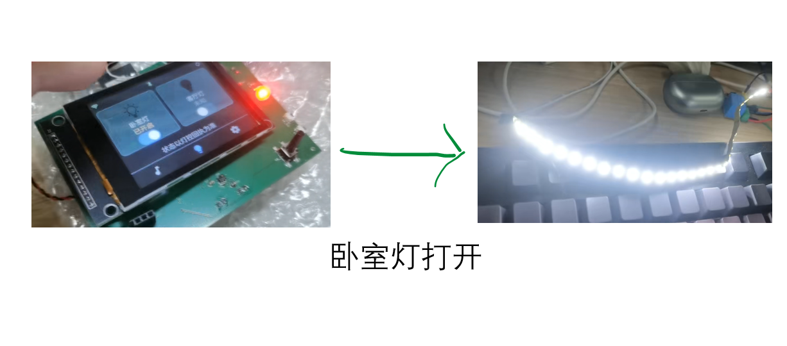

# MusicPlaySyncSpeakers

一套跑在 ESP32 上的**多设备无线音频同步系统**：主节点接收手机/电脑的蓝牙音频（或读 SD 卡本地 MP3）并解码，给每帧 PCM 打上统一的播放时刻后**逐台单播**给多个从节点，实现"手机放歌，全屋音箱同时响"；主节点那块触摸屏还能顺手开关房间灯。

> 目标不是做一个蓝牙音箱，而是验证一条**低成本、可扩展的全屋音频**路径：单主多从、主从各自供放、多台音箱同时出声不错位。

## 架构

### 节点拓扑

```text
                              手机 / 电脑（A2DP Source，44.1k 或 48k）
                                                  │ Bluetooth Classic（SBC，协议栈内解码）
                                                  ▼
┌ Play_Master · ESP32-WROVER-E-N16R8 ──────────────────────────────────────────────────────────────┐
│ bt_audio（A2DP）─────────────┐  44.1k 直通 · 48k 才重采样到 44.1k                                │
│                              ├──▶ sync_protocol · 给每帧打 t_play_us                             │
│ SD 卡 ─▶ audio_decoder ──────┘ · 本地延迟队列 → 功放出声                                         │
│                                 · 逐台单播（一般 ≤ 8 台从节点）                                  │
│ UI（LVGL 触摸屏）· LightControl · wifi_manager · ota_manager                                     │
└────────────────┬─────────────────────────────────┬────────────────────────────────┬──────────────┘
                 ▼                                 ⇅                                ▼
            音频数据面                     控制面（组播）                        灯控面
            单播 5680                       239.0.0.1:5679                   239.0.0.2:8889
  ┌ Play_Slave (1) ────────────┐    ┌ Play_Slave (2) ────────────┐  ┌ ESP8266 灯控 ────────────────┐
  │ ESP32-WROVER-E-N16R8       │    │ ESP32-WROVER-E-N16R8       │  │ 继电器：开 / 关              │
  │ 抖动缓冲 → 定时出声        │    │ 抖动缓冲 → 定时出声        │  │ ack + 30s 状态               │
  │ I2S 功放 · StatusLed       │    │ … 共 N 台（≤ 8）           │  │ 巴法云 · 米家/小爱           │
  └────────────────────────────┘    └────────────────────────────┘  └──────────────────────────────┘
```

### 节点职责

| 节点 | 硬件 | 职责 | 取舍 |
| :--- | :--- | :--- | :--- |
| **主节点** `Play_Master` | ESP32-WROVER-E-N16R8 | 蓝牙 A2DP 接收、SD 卡解码、统一同步调度、本机出声、LVGL 触摸屏、灯控下发、OTA | 唯一有屏 / 有卡 / 有经典蓝牙的节点 |
| **从节点** `Play_Slave` ×N | ESP32-WROVER-E-N16R8 | 收单播 PCM → 抖动缓冲 → 按时刻出声、音量跟随、状态灯 | 无屏、无卡、不解码，单台成本压到最低；一般 2~4 台，上限 8 台 |
| **灯控节点** | ESP8266 + 继电器 | 收 JSON 开关灯，回 ack 与 30s 状态上报；另一路接巴法云 MQTT | 独立工程，代码不在本仓库 |

> 主从用的是**同一款板子**（ESP32-WROVER-E-N16R8），不是两种硬件；固件是两个独立工程（`Play_Master` / `Play_Slave`），各自在 NVS 里存本机参数（`node_role` 也带角色字段）。开发阶段从节点先拿现成的 **ESP32-S3 开发板**顶上，所以 `Play_Slave/sdkconfig` 目前是 `esp32s3` 目标；换到目标硬件时按 `esp32` 目标重建配置即可，业务代码不用改。

## 成品展示

<table>
  <tr>
    <td width="34%"></td>
    <td width="30%"></td>
    <td width="36%"></td>
  </tr>
  <tr>
    <td>主节点：已连接 1/2 · 每台从机带 IP 和信号强度</td>
    <td>从节点：开发板 + 功放 + 喇叭，就这些</td>
    <td>灯控：屏上点一下，卧室灯亮</td>
  </tr>
</table>

录屏（GitHub 不能直接内嵌播放，点开看）：

[UI 操控](ProductShow/Video/UI操控.mp4) · [蓝牙连手机播放](ProductShow/Video/蓝牙连接手机播放.mp4) · [蓝牙连电脑播放](ProductShow/Video/蓝牙连接电脑播放.mp4) · [灯控演示](ProductShow/Video/灯控演示.mp4)

## 能做什么

- **手机或电脑放歌，全屋一起响**——主节点当蓝牙音箱收音频，同一份声音发给所有从节点
- **一个主节点带多台从节点**——一般 2~4 台，最多 8 台；从节点只有主控、功放、喇叭，成本能压到很低
- **从节点不用配**——连上同一个 Wi-Fi 就自动出现，掉线重连、换了 IP 也能自己找回来
- **主节点带触摸屏**——播放 / 暂停 / 切歌 / 音量 / 本地歌单 / 播放模式
- **一块屏顺手管灯**——灯控页点一下开关，也能用米家 App 或小爱同学
- **音量跟着主节点走**——主节点一调，从节点一起变
- **能 OTA 升级**——主节点支持网络升级，升坏了自动回滚

## 硬件清单

| 部件 | 型号 | 主节点 | 从节点 |
| :--- | :--- | :---: | :---: |
| 主控 | ESP32-WROVER-E-N16R8（16MB Flash + 8MB PSRAM） | ✓ | ✓ |
| 屏幕 | 2.8 寸 IPS（ILI9341，320×240）+ 电容触摸 FT6336G | ✓ | — |
| 功放 | NS4168（I2S 输入，2.5W） | ✓ | ✓ |
| 喇叭 | 4Ω 3W | ✓ | ✓ |
| 存储 | Micro SD（SPI，放 `/music` 里的 mp3） | ✓ | — |
| 电源 | IP2325 充电 + 锂电池 | ✓ | ✓ |

灯控节点另算：ESP8266 + 继电器模块 + 一盏灯，独立工程，不在本仓库。

> 主从是同款板子，表里的「—」是**不用装**，不是板子上没有：从节点空着屏、SD 卡槽和麦克风位就行。
>
> 语音唤醒那条链路已经下线，**不用再焊 INMP441 麦克风**。

## 文档导航

细节都在 `docs/` 里，按目录分：

| 目录 | 有什么 |
| :--- | :--- |
| [`docs/01-需求`](docs/01-需求) | 需求规格、验收标准 |
| [`docs/02-设计`](docs/02-设计) | 系统设计、主从分层架构、同步协议、灯控协议、UI 设计、引脚分配 |
| [`docs/03-开发`](docs/03-开发) | 构建烧录指南、模块 API、任务与内存分配、字体接入 |
| [`docs/04-测试`](docs/04-测试) | 测试计划、抓包验证、长稳测试、踩过的坑 |
| [`docs/05-用户`](docs/05-用户) | 操作手册、配网与灯控、故障排查 |
| [`docs/07-许可`](docs/07-许可) | 第三方组件许可与修改记录 |
| [`note/`](note) | 调试笔记：蓝牙、I2S、功放、触摸、电源那些事 |
| [`LightControl/`](LightControl) | 灯控固件（ESP-01S）：独立工程，编译与配网说明看它的 README |

## 三个组件名称

主节点：Play_Master

从节点：Play_Slave

灯控：LightControl（ESP-01S）

## 快速开始

### 主节点 / 从节点（ESP-IDF 6.0.1）

```bash
# 主节点
cd Play_Master && idf.py set-target esp32 && idf.py build flash monitor

# 从节点（开发板是 ESP32-S3，目标板换成 WROVER-E 时改成 set-target esp32）
cd Play_Slave && idf.py set-target esp32s3 && idf.py build flash monitor
```

烧之前把 `node_role` 里的默认 Wi-Fi 名和密码改成自己家的（两个工程要一致，代码里现在是开发期的测试值）。音乐放 SD 卡 `/music` 下，只认 `.mp3`。

音频节点的完整步骤见 [`docs/03-开发/音频节点构建与烧录指南.md`](docs/03-开发/音频节点构建与烧录指南.md)。

### 灯控节点（ESP-01S，另一套工具链）

灯控**不是** ESP-IDF 工程，是冻结的 **ESP8266_RTOS_SDK v3.4** + `xtensa-lx106-elf` 交叉编译器，只能在 MSYS2 的 `mingw32.exe` 里编（Git Bash / PowerShell 里没有工具链）：

```bash
cd LightControl
make menuconfig                          # 串口在这里设，形如 //./COM8
make -j10                                # 编译
make ESPPORT=COM8 ESPBAUD=921600 flash   # 烧录（COM8 换成你自己的口）
make monitor                             # 串口监视器，74880 波特率，Ctrl+] 退出
```

- 板子是 **ESP-01S（ESP8266，1MB Flash）**，分区表用 `partitions_1mb.csv`（单 app 槽，没有 OTA）；
- **下载模式**：GPIO0 接地；**运行模式**：GPIO0 悬空；
- Wi-Fi 凭据存在 NVS，烧一次之后发 `wifi <SSID>,<密码>` 命令就能换网，不用重烧；连不上会自动开热点进配网模式。

工具链放哪、32 位 Python 和 `setuptools < 71` 这些环境细节见 [`LightControl/README.md`](LightControl/README.md)。

## 已知限制

- **主从节点还没有配网界面**，换 Wi-Fi 得改 `node_role` 重新烧（灯控有 AP 配网，不受此限）
- **一个主节点一套网**，不支持多个主节点组大网
- **从节点 OTA 还没接上**，升级要插线
- **灯控也不支持 OTA**，1MB Flash 放不下双槽，换固件要插线
- **灯控是继电器**，只能开 / 关，调不了亮度，目前只接了一盏

## 许可

本项目以 **Apache License 2.0** 发布，见 [LICENSE](LICENSE)。

第三方组件的许可、版本与本地修改记录见 [THIRD_PARTY_NOTICES.md](THIRD_PARTY_NOTICES.md)：

- **minimp3**（MP3 解码）— CC0-1.0，本项目对其打了一处补丁（把 15.5 KB 解码 scratch 移出任务栈），详见 [`docs/07-许可/所用开源/minimp3-授权说明.md`](docs/07-许可/所用开源/minimp3-授权说明.md)
- **LVGL** 9.6.0 — MIT；**FreeType** 2.14.3 — FTL；**cJSON** 1.7.19 — MIT；**ESP-IDF** 6.0.1 — Apache-2.0
- **Noto Sans SC**（中文子集）— OFL-1.1；**Material Icons**（图标位图）— Apache-2.0

未链接任何 GPL / AGPL 组件。

## 致谢

- [lieff/minimp3](https://github.com/lieff/minimp3) — 极简 MP3 解码器
- [LVGL](https://lvgl.io/) — 嵌入式 GUI
- [FreeType](https://freetype.org/) — 字体渲染
- [Noto Sans SC](https://fonts.google.com/noto) / [Material Icons](https://github.com/google/material-design-icons) — 字体与图标
- [ESP-IDF](https://github.com/espressif/esp-idf) — 框架与协议栈

> 本项目为个人学习与验证性质，硬件与音质未做产品级认证；自行复刻请注意功放供电与散热。

## 项目版本：

> data:2026-10-31

0.1